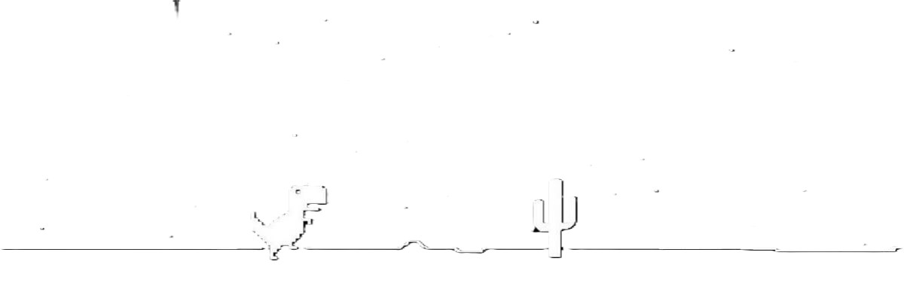
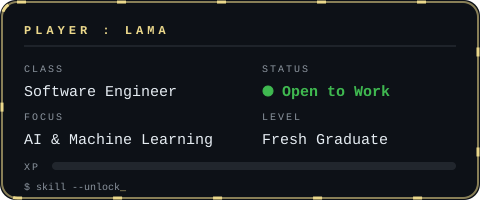
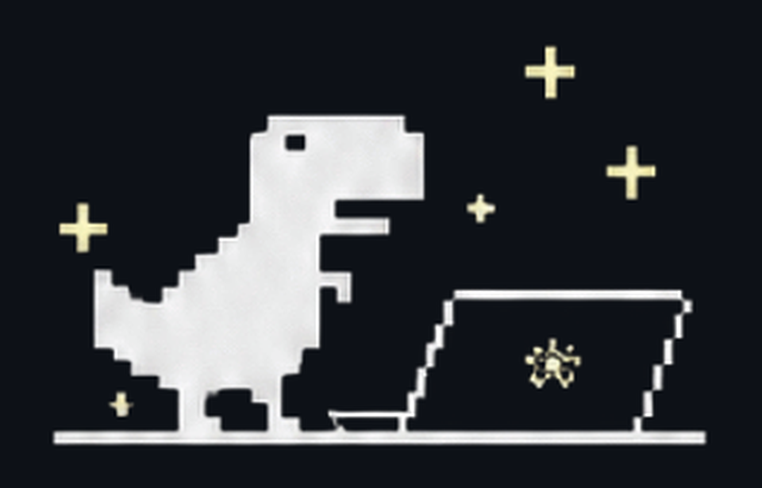
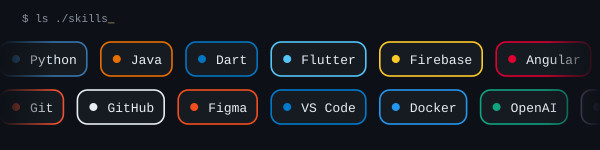
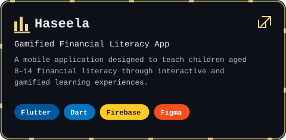
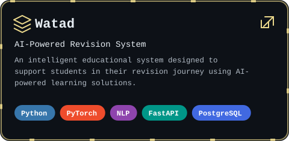

  

  

  

  

---

## 🚀 About Me

<table>
<tr>
<td width="55%" valign="top">

■ Software Engineering Graduate from King Saud University.

■ Interested in Artificial Intelligence and Machine Learning.

■ Passionate about Data Analytics and intelligent applications.

■ Enjoy building practical solutions and learning new technologies.

</td>
<td width="45%" align="center">

</td>
</tr>
</table>

---

## 🔗 Connect

  
  &nbsp;
  

---

## 🧩 Tech Stack

  

  

  
  
  

---

## 📦 Projects

  
   
  
  

  
   
  
  

---

## 🏅 Certifications

■ CAPM® – Certified Associate in Project Management

■ Microsoft Azure AI Fundamentals (AI-900)

---

  ―――― + ★ + ――――
   
  <i>Always learning. Always building. Always improving.</i>

