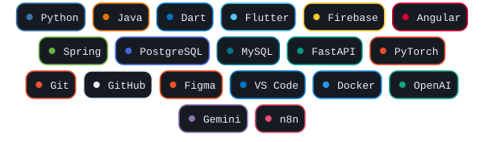
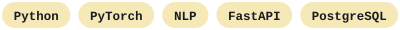

  

  

  

  

---

<h2 align="center">🚀 About Me</h2>

  ■ Software Engineering Graduate from King Saud University.  
  ■ Interested in Artificial Intelligence and Machine Learning.  
  ■ Passionate about Data Analytics and intelligent applications.  
  ■ Enjoy building practical solutions and learning new technologies.

---

<h2 align="center">🔗 Connect</h2>

  
  &nbsp;&nbsp;
  

---

<h2 align="center">🧩 Tech Stack</h2>

  

---

<h2 align="center">📦 Projects</h2>

<table>
  <tr>
    <td align="center" width="34%">
      
    </td>
    <td align="center" width="66%">
      <h3><a href="WATAD_LIVE_LINK">Watad ↗</a></h3>
      <b>AI-Powered Revision System</b> 
      An intelligent educational platform designed to help students improve their learning and revision experience through AI-powered solutions.  
        
      
      
    </td>
  </tr>
  <tr>
    <td align="center" width="34%">
      
    </td>
    <td align="center" width="66%">
      <h3><a href="HASEELA_LIVE_LINK">Haseela ↗</a></h3>
      <b>Gamified Financial Literacy App</b> 
      A gamified mobile application designed to teach children aged 8–14 financial literacy through interactive activities and engaging learning experiences.  
        
      
      
    </td>
  </tr>
</table>

---

<h2 align="center">🏅 Certifications</h2>

  ■ CAPM® – Certified Associate in Project Management  
  ■ Microsoft Azure AI Fundamentals (AI-900)

---

  ―――― + ★ + ――――
   
  <i>Always learning. Always building. Always improving.</i>

